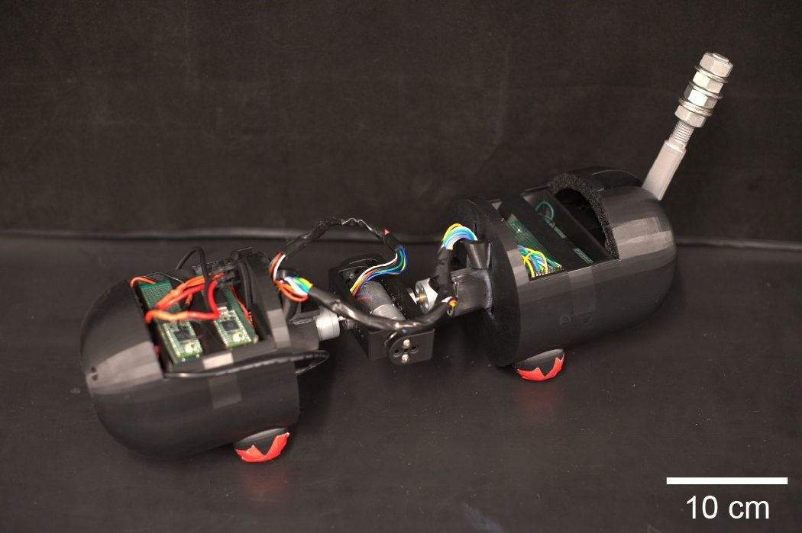

# MeowMentum

**A multi-strategy aerial self-righting robot for evaluating the contribution of an actuated tail across fall conditions.**

[Project page](https://ichoi02.github.io/MeowMentumV2/) · [Drop data](data/hardware_trials) · [Analysis](analysis)

<p align="center"></p>

MeowMentum is a 1.86 kg robot that rights itself in free fall. Two body segments are
joined by an actuated two-degree-of-freedom spine (pitch plus a coupled roll pair), and a
one-degree-of-freedom tail is mounted on the rear segment. A policy trained only in
MuJoCo, first as a privileged SAC teacher and then distilled with DAgger into a student
that sees only onboard sensors, runs at 50 Hz on a Raspberry Pi. It was deployed to the
robot without tuning. Dropping the robot with and without its tail from a range of roll
and pitch attitudes shows that the tail improves whole-body righting overall and across
roll releases. Across pitch releases its extra benefit is less clear.

This repository contains the code, the policies that flew, every hardware drop log, and
the analysis that produces the paper's figures and tables.

## Repository layout

| Path | Contents |
|---|---|
| `cat_env/`, `model/` | Gymnasium/MuJoCo environment and the models for both morphologies (`cat.xml`, `cat_notail.xml`) |
| `train.py`, `smooth_sac.py` | SAC teacher training on the privileged state, with a temporal smoothness term in the actor loss |
| `distillation.py` | DAgger distillation into the 11-dim onboard-observation student |
| `onnx_conversion.py` | Student → ONNX export for the Raspberry Pi |
| `evaluate.py`, `view_policy.py` | Simulation evaluation at fixed release attitudes; interactive MuJoCo viewer |
| `policies/` | The deployed teachers, students and ONNX files ([provenance](#released-policies)) |
| `hardware/` | Raspberry Pi controller, Teensy firmware, flashing tools ([hardware/README.md](hardware/README.md)) |
| `tools/` | ONNX/telemetry verification and the PD-gain step-response sweep |
| `data/hardware_trials/` | 73 hardware drop logs at 50 Hz with a manifest ([data/README.md](data/README.md)) |
| `analysis/` | Whole-cat score, statistics, Fig. 4 and Fig. 5 ([analysis/README.md](analysis/README.md)) |
| `results/` | Generated tables and figures, and the training logs of the deployed teachers |
| `docs/` | Project page (GitHub Pages) |

## Install

Python 3.10. From the repository root:

```bash
python3.10 -m venv .venv && source .venv/bin/activate
pip install -r requirements.txt
```

The pins are the environment this release was verified in. The robot itself needs only
numpy, scipy, gymnasium, onnxruntime and pyserial (see `hardware/README.md`). Every script
can be run from any working directory.

## Reproduce the paper's hardware results

```bash
python analysis/reproduce.py
```

This takes about 30 s. It recomputes the whole-cat score of every drop, the ANCOVA with
HC3 errors, the Holm adjustment and the blocked permutation tests (Table II), the
1 m / 2 m tilt values, Fig. 4 and Fig. 5. Everything is written to `results/`, and the
numbers are checked against the paper; the script exits non-zero on any mismatch.

| | No tail | With tail | Adjusted tail effect | 95% HC3 CI | *p* |
|---|---|---|---|---|---|
| All releases | 0.688 ± 0.155 (37) | 0.798 ± 0.090 (35) | +0.157 | [0.062, 0.252] | 0.0016 |
| Roll sweep | 0.627 ± 0.140 (19) | 0.807 ± 0.086 (17) | +0.185 | [0.075, 0.296] | 0.0019 |
| Pitch sweep | 0.715 ± 0.164 (24) | 0.789 ± 0.092 (24) | +0.114 | [−0.057, 0.286] | 0.1841 |

## Verify the deployed policies

```bash
python tools/verify_onnx.py --replay
```

This checks that the ONNX files are bit-identical to the PyTorch students and agree with
them to float32 rounding. It then replays every hardware log through both policies. The
logged joint targets are reproduced to within a few 1e-15 by exactly one policy, which
identifies the controller that flew each drop.

`python hardware/e2e_test.py --variant tail` (or `notail`) checks, without hardware, that
the controller's observation, filtering and joint mapping match the simulator, and that the
ONNX student still rights the robot in closed loop.

## Train from scratch

```bash
python train.py --variant tail                 # SAC teacher, 1M steps, 10 envs
python distillation.py --variant tail          # DAgger student, 50 x 2,000 steps
python onnx_conversion.py --variant tail       # policies/cat_controller.onnx
```

Run the same with `--variant notail`. `train.py` and `distillation.py` write timestamped
checkpoints to `policies/`. Copy them to the canonical names (`cat_controller<suffix>.zip`,
`student_policy<suffix>.pth`) before the next stage. TensorBoard logs go to `run_logs/`.

The defaults are the configuration of the released teachers:
- **Reward.** `r = 1.5·(½(u_f + u_r) + u_f·u_r) − 0.002·mean(ω²)`, with `u_i = 1 − φ_i/π`, where
  φ_i is the angle between body *i*'s up vector and the world up vector.
  - The torque, joint-velocity and simultaneity penalties have zero weight.
  - Dividing by 3 gives the paper's normalisation, `¼(u_f + u_r) + ½u_f·u_r`, with an
    angular-velocity weight of about 6.7e-4.
- **Smoothness.** The actor-loss smoothness coefficient is 2.0.

Weights can be overridden without code changes through `CAT_W_POS`, `CAT_W_EN`,
`CAT_W_AV`, `CAT_W_JV` and `CAT_W_TIME`. Domain randomisation draws from the global NumPy
RNG in each worker, so training runs are not bit-reproducible.

To evaluate or watch a policy in simulation:

```bash
python evaluate.py --variant tail --agent student --roll 180 --pitch 45
mjpython view_policy.py --variant tail --roll 180 --pitch 45 --slow 0.2    # python on Linux
```

## Released policies

`policies/` holds exactly what flew in the Aug 10, 16 and 17, 2026 drop experiments:

| File | What | sha256 (prefix) |
|---|---|---|
| `cat_controller.zip`, `cat_controller_notail.zip` | SAC teachers (2026-08-08, run `av002`) | `a9109065`, `bfcad505` |
| `student_policy.pth`, `student_policy_notail.pth` | DAgger students (MLP 11-256-256-3, tanh) | `ed3ec97b`, `befc4f4d` |
| `cat_controller.onnx`, `cat_controller_notail.onnx` | ONNX exports run on the Raspberry Pi | `c88c79ca`, `8f3e6990` |

With torch 2.10.0, onnx 1.21.0 and onnxscript 0.6.2, `onnx_conversion.py` reproduces both
ONNX files byte for byte. The no-tail student was distilled with the raw tail action fed
back as its previous action (`prev_action[2]`), whereas the robot and `evaluate.py` feed
back 0. This is documented in `distillation.py` and left unchanged so the code matches
the released policy.

## Hardware

Two Teensy 4.0 boards run 1 kHz PD loops for the four joints. The front board carries a
BNO085 IMU. A Raspberry Pi detects free fall (|a| < 3.5 m/s²), runs the ONNX student at
50 Hz for one second and logs every step. Wiring, flashing, the start-up procedure, the
observation layout and the telemetry format are in [hardware/README.md](hardware/README.md).

## Data notes

The drop logs are kept exactly as recorded. [data/README.md](data/README.md) and
`data/hardware_trials/MANIFEST.csv` document three points:
- **Excluded short drop.** One with-tail drop reached impact before the 2.5 m evaluation
  point. It is excluded from the whole-cat score, so the with-tail n is 35.
- **No-tail drops flown with the with-tail policy.** Replay shows that 19 of the 37
  no-tail drops were flown with the with-tail policy: every no-tail pitch-sweep drop and
  one roll-180 drop. The controller defaulted to `--variant tail` at the time; the flag
  is now required.
- **Date labels.** Four filename date labels do not match the git history of the logs.

## Project page

The page in `docs/` is static and has no build step. To publish it, open
Settings → Pages, choose *Deploy from a branch*, and select this branch and the `/docs`
folder. To preview it locally, run `python -m http.server --directory docs` and open
http://localhost:8000. `docs/assets/data/build_page_data.py` regenerates the page's data
from `data/`, `results/` and the policies.

## Citation

```bibtex
@inproceedings{meowmentum,
  title     = {{MeowMentum}: A Multi-Strategy Aerial Self-Righting Robot for Evaluating
               the Contribution of an Actuated Tail Across Fall Conditions},
  author    = {Anonymous},
  booktitle = {Under review},
  year      = {2026}
}
```
